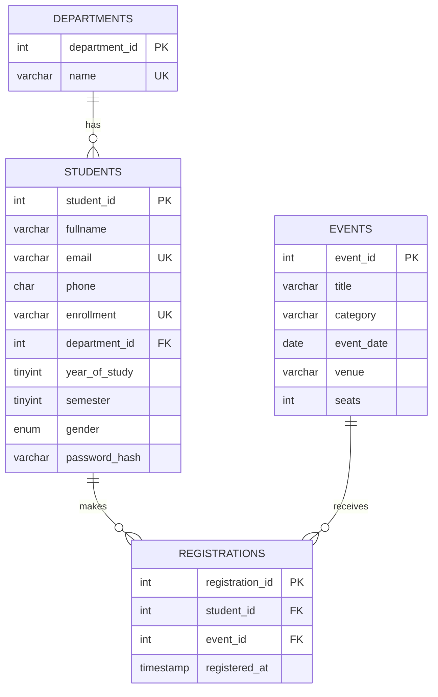

# StudentHub ER Diagram and Normalization Notes

**Relationships:** Department 1:N Student. Student M:N Event, resolved by the `registrations` junction table.

**Normalization:**
- 1NF: every column is atomic, every table has a primary key.
- 2NF: `registrations` uses a surrogate key plus `UNIQUE(student_id, event_id)`; its non-key data (`registered_at`) depends on the whole pair.
- 3NF: department name is stored once in `departments`, not repeated per student, so there are no transitive dependencies.

**Keys and integrity:** FKs use `ON DELETE CASCADE` for registrations (deleting a student/event removes its registrations) and `ON DELETE RESTRICT` for departments (a department in use cannot be deleted). `UNIQUE` on email and enrollment prevents duplicates; `CHECK` constraints limit year (1-4) and semester (1-8).
